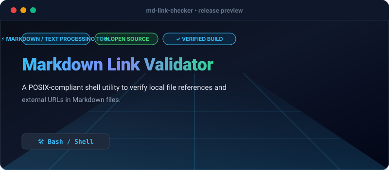

# Markdown Link Validator

[](https://github.com/Olamideakinade/md-link-checker)
[](https://opensource.org/licenses/MIT)



A simple, dependency-light shell script to validate Markdown link integrity. It checks local file paths and sends HEAD requests to external URLs to ensure they are reachable.

## Capabilities
- Validates local file existence for relative links.
- Verifies external URLs using `curl`.
- Provides exit codes for CI/CD integration.
- Minimal footprint (only requires `bash`, `curl`, and `grep`).

## Usage
```bash
./check.sh README.md
```

## Output Example
```text
[OK] ./docs/install.md
[FAIL] https://example.com/missing-page (404)
[OK] https://google.com (200)
```

## License
MIT